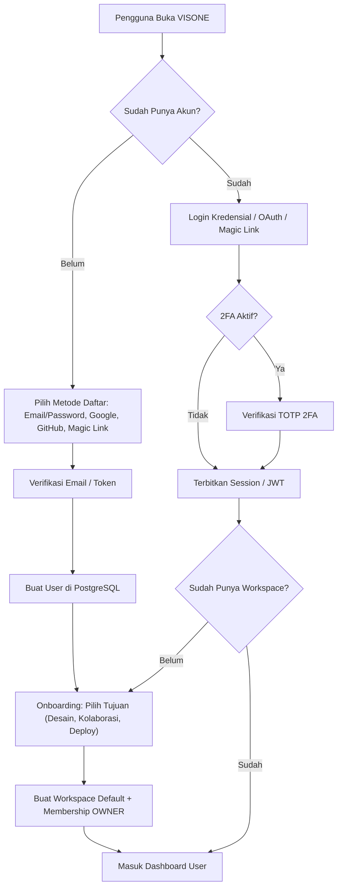
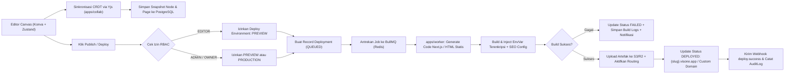
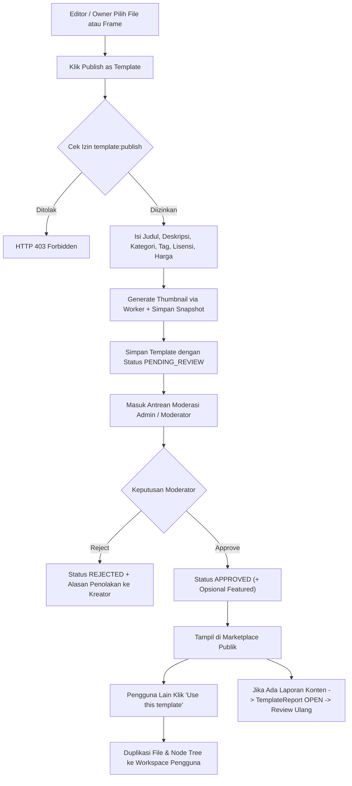
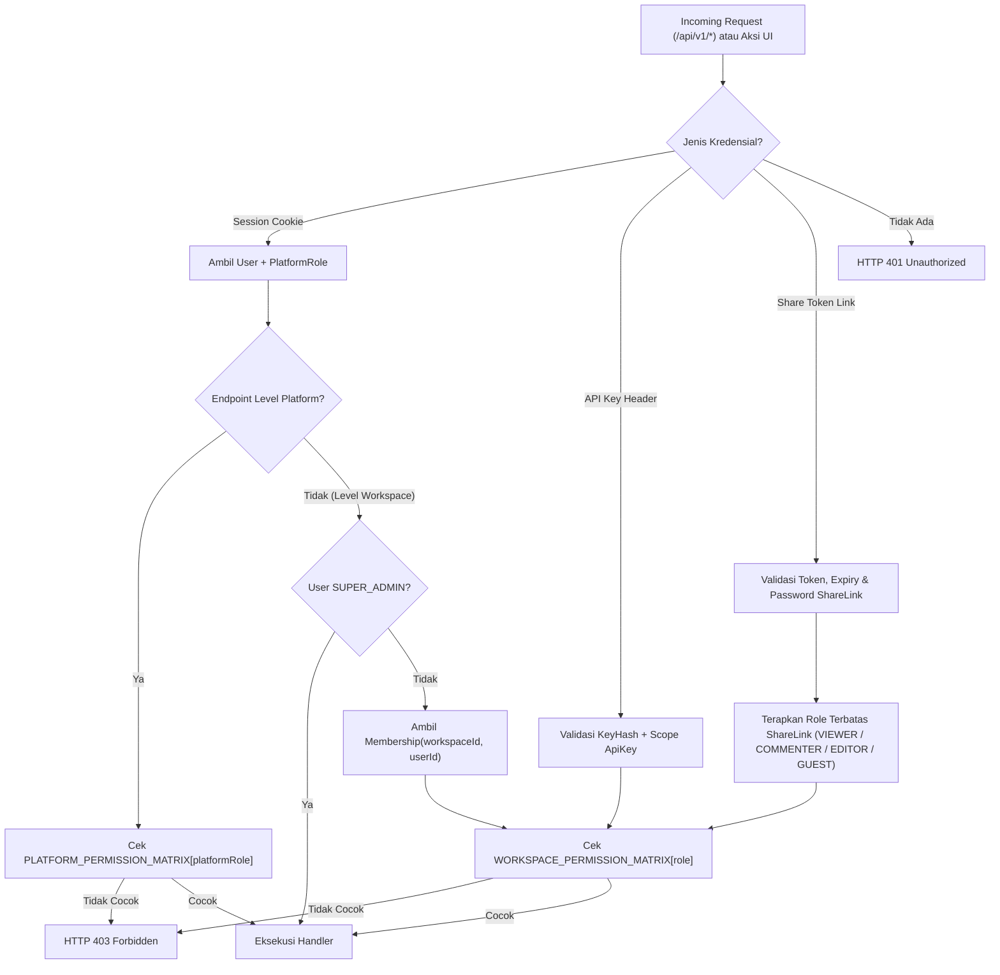

# VISONE — Diagram Alur Sistem (Mermaid)

## 1. Auth Flow (Register, Login, OAuth, 2FA & Onboarding)

## 2. Editor-to-Deploy Flow

## 3. Template Publish & Moderation Flow

## 4. Permission Check Flow (API Guard & UI Visibility)

